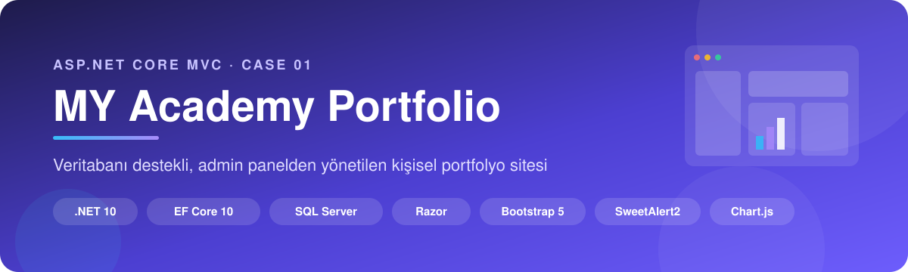
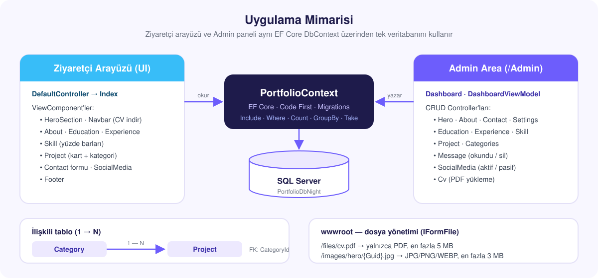
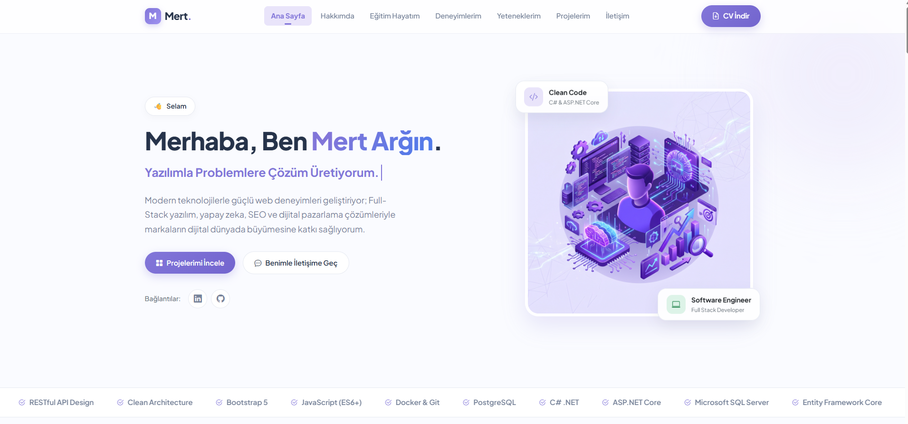
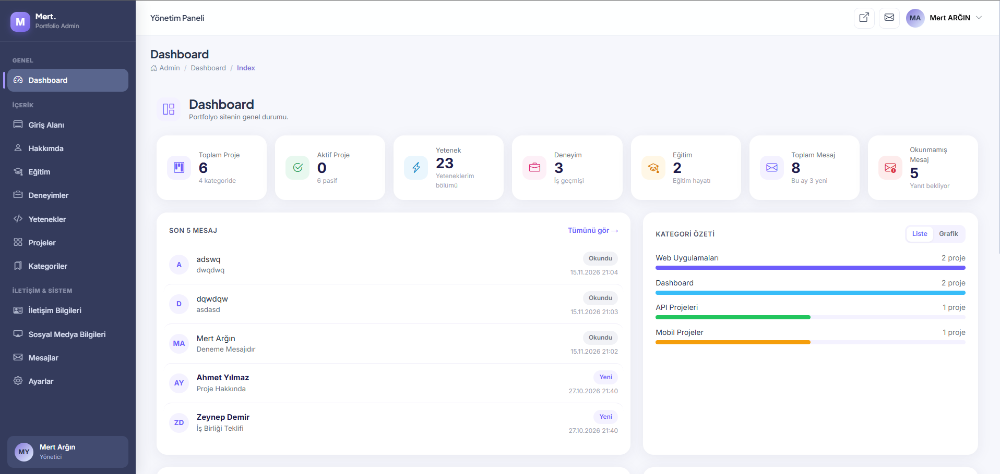
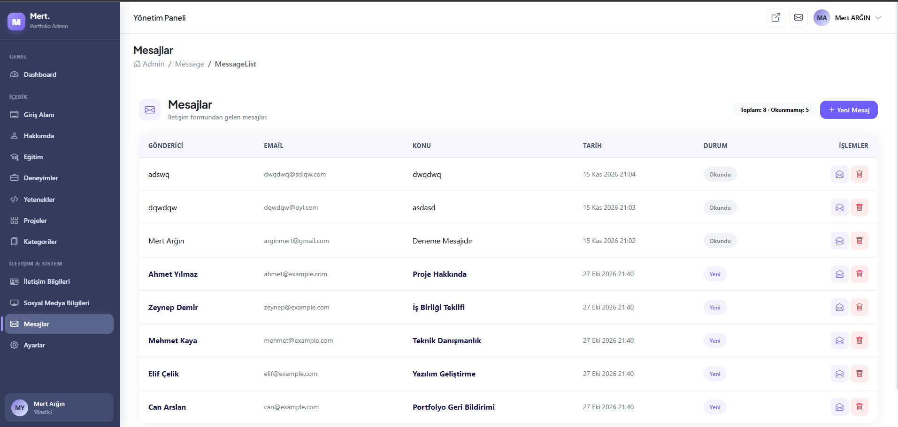
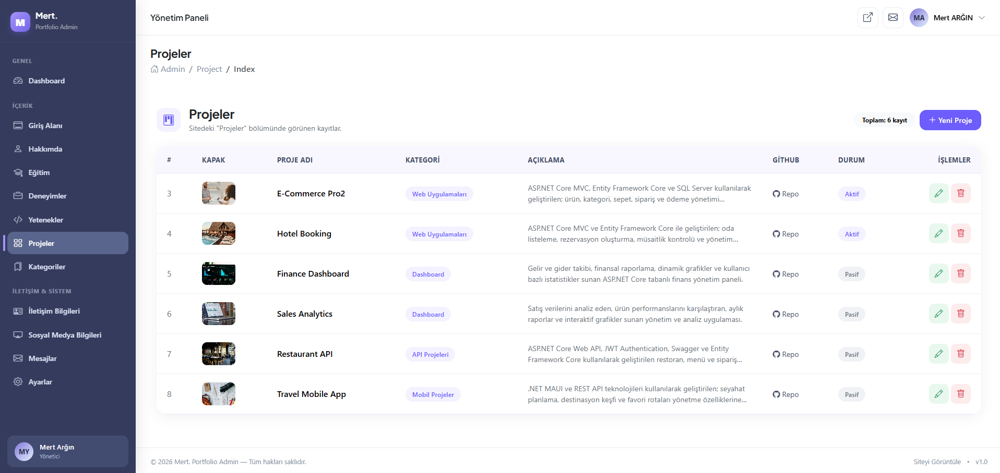

<p align="center">
  
</p>

<p align="center">
  
  
  
  
  
  
</p>

# 💼 MY Academy Portfolio

> **M&Y Yazılım Eğitim Akademi — 12. Dönem Akşam Grubu, 1. Proje (Case 01)**
>
> Statik bir portfolyo şablonunu ve admin tasarımını; **ASP.NET Core MVC**, **Entity Framework Core (Code First)** ve **SQL Server** kullanarak veritabanı destekli, admin panelinden yönetilen dinamik bir web uygulamasına dönüştürdüm.

Sitedeki her şey (ad-unvan, profil fotoğrafı, eğitimler, deneyimler, yetenekler, projeler, sosyal medya linkleri, iletişim bilgileri, CV dosyası) admin panelinden değiştirilebilir ve değişiklik anında ziyaretçi tarafında görünür.

---

## 📑 İçindekiler

- [Kullanılan Teknolojiler](#️-kullanılan-teknolojiler)
- [Mimari](#️-mimari)
- [Özellikler](#-özellikler)
  - [Ziyaretçi Arayüzü](#-ziyaretçi-arayüzü)
  - [Admin Paneli](#️-admin-paneli)
  - [Dashboard](#-dashboard)
  - [Mesaj Yönetimi](#-mesaj-yönetimi)
  - [CV İndirme ve Yükleme](#-cv-i̇ndirme-ve-yükleme)
- [Uygulanan Teknikler](#-uygulanan-teknikler)
- [Proje Yapısı](#-proje-yapısı)
- [Kurulum](#-kurulum)
- [Ekran Görüntüleri](#-ekran-görüntüleri)

---

## 🛠️ Kullanılan Teknolojiler

| Katman | Teknoloji |
|---|---|
| **Backend** | ASP.NET Core MVC (.NET 10), C# |
| **ORM** | Entity Framework Core 10 — Code First + Migrations |
| **Veritabanı** | Microsoft SQL Server (Express) |
| **View Motoru** | Razor (`.cshtml`), Tag Helpers, **View Components** |
| **Arayüz** | Bootstrap 5.3, Bootstrap Icons, özel CSS |
| **Bildirim / Popup** | SweetAlert2, TempData |
| **Grafik** | Chart.js 4 |
| **Mimari** | MVC + **Areas** (`/Admin`) ile ayrılmış yönetim paneli |

---

## 🏗️ Mimari

<p align="center">
  
</p>

- **Ziyaretçi tarafı** tek bir sayfadan (`DefaultController/Index`) oluşur. Sayfanın her bölümü ayrı bir **View Component** olarak yazıldı; her component kendi verisini `PortfolioContext` üzerinden çeker. Böylece layout parçalı, okunabilir ve tekrar kullanılabilir oldu.
- **Admin paneli** `Areas/Admin` altında tamamen ayrı tutuldu. Admin layout'u da (head, sidebar, mobil sidebar, style, script) View Component'lere bölündü.
- Veritabanı **Code First** yaklaşımıyla oluşturuldu; şema değişiklikleri **migration** dosyalarıyla takip edildi.

---

## ✨ Özellikler

### 🌐 Ziyaretçi Arayüzü

| Bölüm | Açıklama |
|---|---|
| **Hero** | Ad, unvan, tanıtım metni ve profil fotoğrafı veritabanından gelir. |
| **Navbar** | Bölüm linkleri (`#about`, `#projects`, `#contact` …) ilgili alanlara kaydırır. **CV İndir** butonu sunucudaki PDF'e bağlıdır. |
| **Hakkımda** | Konum, uzmanlık, e-posta, "işe açık" durumu dinamik. |
| **Eğitim & Deneyim** | Timeline (zaman çizelgesi) görünümünde listelenir. |
| **Yetenekler** | Kategori kartları içinde, seviye **yüzde barları** ile gösterilir. |
| **Projeler** | Kart yapısında; kapak görseli, **kategori adı** (Include ile), açıklama ve GitHub linki. |
| **İletişim** | Form ile gönderilen mesajlar veritabanına kaydedilir; hatalar ve başarı mesajı SweetAlert2 ile gösterilir. |
| **Sosyal Medya** | Yalnızca **aktif** işaretlenen bağlantılar görünür. |

### ⚙️ Admin Paneli

| Modül | Yapılanlar |
|---|---|
| **Hero** | Başlık, alt başlık, açıklama güncelleme + **IFormFile ile profil fotoğrafı yükleme** (uzantı/boyut kontrolü, `Guid` ile benzersiz dosya adı, eski görselin silinmesi, canlı önizleme) |
| **Hakkımda** | Güncelleme |
| **Eğitim** | Listeleme, ekleme, güncelleme, silme |
| **Deneyim** | Listeleme, ekleme, güncelleme, silme, aktif/pasif anahtarı |
| **Yetenekler** | CRUD, kategori/ikon/renk seçimi, seviye bilgisi |
| **Kategoriler** | Tam CRUD ekranı |
| **Projeler** | Listeleme (kategori adıyla), ekleme/güncelleme formunda veritabanından gelen **kategori dropdown'ı** |
| **Sosyal Medya** | Ekleme, silme, tek tıkla **aktif ↔ pasif**, ikon seçici ve ikon arama |
| **İletişim Bilgileri** | Footer ve iletişim alanındaki bilgilerin güncellenmesi |
| **Ayarlar** | Site başlığı / açıklaması — Data Annotations ile doğrulama |
| **CV** | PDF yükleme ve mevcut dosya bilgisi (tarih, boyut) |

### 📊 Dashboard

Tüm veriler sabit sayılarla değil, **EF Core sorgularıyla** üretilir ve tek bir **`DashboardViewModel`** ile View'a taşınır.

- **İstatistik kartları:** proje, kategori, yetenek, deneyim / eğitim, toplam mesaj, okunmamış mesaj, bu ay gelen mesaj
- **Kategoriye göre projeler** grafiği (`Categories.Select(c => c.Projects.Count)`)
- **Mesaj okunma oranı** (doughnut grafik)
- **Son 6 ay gelen mesajlar** grafiği
- **Son 5 mesaj** (`OrderByDescending(m => m.SendDate).Take(5)`)
- **Site tamamlanma yüzdesi:** Hakkımda dolu mu, CV yüklü mü, GitHub linki olmayan proje / boş kategori var mı → eksik olana "Düzenle →" kısayolu
- **Hızlı erişim** kısayolları

### 📬 Mesaj Yönetimi

- İletişim formu `ContactFormViewModel` ile **sunucu tarafında doğrulanır** (`Required`, `StringLength`, `EmailAddress` + `ModelState.IsValid`), form `[ValidateAntiForgeryToken]` ile korunur.
- Hatalı gönderimde kullanıcının yazdıkları kaybolmaz; TempData ile forma geri taşınır.
- Admin gelen kutusunda **okundu / yeni** etiketi, okunmamış sayacı, tarihe göre (yeniden eskiye) sıralama.
- Mesaja tıklanınca detay popup'ta açılır ve **AJAX (fetch) ile otomatik "okundu"** işaretlenir; sayaç sayfa yenilenmeden azalır.
- Silme öncesi **SweetAlert2 onay penceresi**. Gelen mesajın içeriği düzenlenemez (yalnızca okunur).

### 📄 CV İndirme ve Yükleme

Bu tasarıma özel görev için şu yaklaşım uygulandı:

- CV dosyası sunucuda sabit bir konumda tutulur: **`wwwroot/files/cv.pdf`**
- Admin panelindeki **CV** ekranından yeni dosya yüklenince eskisinin üzerine yazılır.
- **Yalnızca PDF kabul edilir:** hem uzantı (`.pdf`) hem `ContentType` (`application/pdf`) kontrol edilir, en fazla **5 MB**.
- Ana sayfadaki **CV İndir** butonu dosyaya `download` linki ile bağlanır; URL'ye sürüm parametresi (`?v=`) eklenerek tarayıcının eski CV'yi önbellekten getirmesi engellenir.

---

## 🧠 Uygulanan Teknikler

| Konu | Kullanım |
|---|---|
| **View Component** | Ziyaretçi sayfasının tüm bölümleri ve admin layout parçaları |
| **Areas** | Admin paneli `/Admin` altında izole |
| **Code First & Migration** | `mg1` → `AddSettings` arası migration geçmişi |
| **İlişkili veri** | `Category` 1 → N `Project` (FK `CategoryId` + Navigation Property), `Include(x => x.Category)` |
| **LINQ** | `Where`, `Count`, `OrderByDescending`, `Take`, `GroupBy`, `Select` |
| **SelectList** | Proje formunda kategori dropdown'ı (`SelectListItem`) |
| **Data Annotations** | `Required`, `StringLength`, `EmailAddress` + `ModelState.IsValid` |
| **Dosya yönetimi** | `IFormFile`, tür/boyut kontrolü, `Guid` ile benzersiz ad, `wwwroot` altında saklama |
| **Bildirim** | SweetAlert2 (detay, silme onayı, sonuç), `TempData` ile başarı/hata mesajları |
| **Güvenlik** | `[ValidateAntiForgeryToken]`, mesaj içeriğinin `textContent` ile basılması (XSS'e karşı) |
| **ViewModel** | `DashboardViewModel`, `ContactFormViewModel`, `ChartItem` |

---

## 📁 Proje Yapısı

```
MYAcademy_Portfolio/
├── Areas/
│   └── Admin/
│       ├── Controllers/        # Dashboard, Hero, About, Education, Experience, Skill,
│       │                       # Project, Categories, Message, SocialMedia, Contact, Settings, Cv
│       ├── Models/             # DashboardViewModel, ContactFormViewModel
│       ├── ViewComponents/     # Admin layout parçaları
│       └── Views/
├── Context/
│   └── PortfolioContext.cs     # DbContext
├── Controllers/
│   └── DefaultController.cs    # Ziyaretçi ana sayfası
├── Entities/                   # About, Category, Project, Skill, Experience, Education,
│                               # Message, HeroSection, SocialMedia, Contact, Setting
├── Migrations/
├── ViewComponents/
│   └── DefaultViewComponents/  # Hero, Navbar, About, Education, Experience, Skill,
│                               # Project, Contact, SocialMedia, Footer ...
├── Views/
└── wwwroot/
    ├── files/cv.pdf
    └── images/hero/
```

---

## 🚀 Kurulum

1. Repoyu klonlayın:
   ```bash
   git clone https://github.com/<kullanici-adi>/MYAcademy_Portfolio.git
   ```
2. `Context/PortfolioContext.cs` içindeki bağlantı cümlesini kendi SQL Server'ınıza göre düzenleyin:
   ```csharp
   optionsBuilder.UseSqlServer("Server=.\\SQLEXPRESS;Database=PortfolioDbNight;integrated security=true;trust server certificate=true;");
   ```
3. Veritabanını oluşturun:
   ```bash
   dotnet ef database update
   ```
   *(veya Visual Studio → Package Manager Console → `Update-Database`)*
4. Projeyi çalıştırın:
   ```bash
   dotnet run
   ```
5. Adresler:
   - 🌐 Portfolyo: `https://localhost:<port>/Default/Index`
   - ⚙️ Admin Paneli: `https://localhost:<port>/Admin/Dashboard/Index`

---

## 📸 Ekran Görüntüleri

> Görselleri `docs/images/` klasörüne ekleyip aşağıdaki yolları güncelleyebilirsiniz.

| Ana Sayfa | Dashboard |
|---|---|
|  |  |

| Mesajlar | Proje Yönetimi |
|---|---|
|  |  |

---

<p align="center">
  M&Y Yazılım Eğitim Akademi · 12. Dönem Akşam Grubu için geliştirildi 💜
</p>
